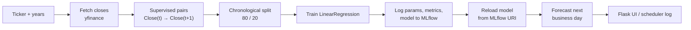

# Stock Price Prediction with MLOps

An end-to-end MLOps demo that predicts a stock's **next trading day closing price**. Every prediction fetches live data from Yahoo Finance, trains a fresh model, logs the run (parameters, metrics and the model itself) to **MLflow**, reloads the logged model and serves the forecast in a **Flask** web app with an interactive **Plotly** chart. A scheduler can run the same pipeline automatically every day.

A second page, the **Day Trader Lab**, runs the 11 skills of the [day-trader-skill](https://github.com/Jakeschincariol/day-trader-skill) pack from the browser and shows, step by step and in plain words, what each one does behind the scenes.

---

## ✨ Features

- **Clean web UI**: light/dark theme, quick-pick tickers, 1Y / 2Y / 5Y history, loading state and a mobile-friendly layout.
- **Result dashboard**: predicted close with change vs. last close, test RMSE / R² / MAE, an interactive chart (actual prices, model output on the test period, forecast point, 1M/3M/6M/All ranges), a recent-closes table and the MLflow run ID.
- **Honest evaluation**: chronological train/test split (the last 20% of days are held out, no shuffling), with train *and* test metrics logged.
- **MLflow tracking**: each run is named `<SYMBOL>-<N>y` in the `stock-price-prediction` experiment and records the symbol, history length, split sizes, MSE/RMSE/MAE/R² and the serialized model.
- **Shareable results**: predictions are plain GET URLs, e.g. `/predict?symbol=NVDA&years=2`.
- **Scheduler with a CLI**: choose the symbols and time, or run once with `--now`.
- **Works offline-first**: plotly.js is served from the installed Python package, so no chart CDN is needed.
- **Day Trader Lab** (`/trader`): every day-trading skill (scanner, news, entry timer, exit planner, time machine, budget, risk, order tickets, alerts, earnings analyst, Congress trade tracker) with a form, a live step-by-step timeline of the run, plain-English explanations of the result and drawings of the saved files. A demo mode replays a real trade from Oct 19 2026 at any hour, without the internet.

---

## 🏗️ Pipeline



---

## 📁 Project Structure

```plaintext
predicting_stock_prices/
├── app.py                    # Web entry point: python app.py
├── scheduler.py              # Daily automated predictions (CLI)
├── requirements.txt
│
├── stock_predictor/          # Application package
│   ├── config.py             # All settings (env-var overridable)
│   ├── data.py               # Ticker validation, fetching, feature/label prep, split
│   ├── model.py              # Training, metrics, MLflow logging & loading
│   ├── pipeline.py           # run_prediction(): end-to-end flow + PredictionResult
│   ├── charts.py             # Chart / table data for the result page
│   ├── web.py                # Flask app factory and routes
│   └── trader/               # Day Trader Lab
│       ├── catalog.py        # The 11 skills: actions, form fields, plain-English steps, glossary
│       ├── runner.py         # Validates input, runs a skill script, streams its output
│       └── routes.py         # /trader page and its JSON API
│
├── templates/
│   ├── base.html             # Layout: header, theme toggle, loading overlay
│   ├── index.html            # Search page
│   ├── result.html           # Prediction dashboard
│   └── trader.html           # Day Trader Lab
│
├── static/
│   ├── css/style.css         # Design tokens (light/dark) and components
│   ├── css/trader.css        # Day Trader Lab styles
│   └── js/
│       ├── app.js            # Theme toggle, loading state, chips, copy button
│       ├── chart.js          # Plotly chart, themed from CSS tokens
│       └── trader.js         # Day Trader Lab: forms, live run timeline, result drawings
│
├── vendor/day_trader_skill/  # The skill pack, unmodified (MIT), see vendor/README.md
├── trader_workspace/         # Files the skills write, one folder per mode (git-ignored)
└── mlruns/                   # MLflow tracking store (git-ignored)
```

---

## 🛠️ Technology Stack

| Component | Technology |
| :--- | :--- |
| Language | Python 3.10+ |
| Web | Flask, Jinja2, vanilla CSS/JS |
| MLOps | MLflow 3 |
| Model | scikit-learn `LinearRegression` |
| Data | yfinance, pandas, NumPy |
| Charts | Plotly.js |
| Scheduling | schedule |

---

## 🚀 Getting Started

```powershell
python -m venv venv
.\venv\Scripts\Activate.ps1        # macOS/Linux: source venv/bin/activate
pip install -r requirements.txt
```

### Web app

```powershell
python app.py
```

Open **http://127.0.0.1:5005**, type a ticker (or click one of the popular ones), pick how much history to train on and press **Predict**.

### MLflow dashboard

```powershell
mlflow ui --port 5001
```

Open **http://127.0.0.1:5001** and select the `stock-price-prediction` experiment to compare runs, metrics and logged models.

### Day Trader Lab

With the web app running, open **http://127.0.0.1:5005/trader** (or click **Day Trader** in the top bar).

- **Demo replay** (the default) uses real data recorded on Monday Oct 19 2026 and pins the clock to that day. Click through steps 1 to 8 in order: each skill reads what the one before saved. No internet needed.
- **Live data** reads free public data right now: Yahoo Finance, SEC EDGAR, Nasdaq Trader and the House Clerk. No API keys. The intraday skills only find something while the NYSE is open (9:30 to 16:00 New York time).
- **Settings** holds your rules (budget, max loss per trade, trading hours...). In live mode, the News Monitor's SEC filings and the Earnings Analyst need your name and email there: the SEC asks every visitor to identify themselves.
- Nothing on the page can place an order. The Order Executor shows the ticket and keeps a paper log; it is not connected to any broker.
- Optional: install [Poppler](https://poppler.freedesktop.org/) so `pdftotext` is on the PATH, and the Pelosi Tracker can read congressional trade report PDFs itself.

### Scheduler

```powershell
python scheduler.py                         # AAPL every day at 12:00
python scheduler.py MSFT NVDA --at 09:30    # custom symbols and time
python scheduler.py TSLA --years 2 --now    # run once immediately and exit
```

---

## ⚙️ Configuration

All settings live in `stock_predictor/config.py` and can be overridden with environment variables:

| Variable | Default | Description |
| :--- | :--- | :--- |
| `PORT` | `5005` | Web server port (`$env:PORT="8080"; python app.py`) |
| `HOST` | `127.0.0.1` | Web server bind address |
| `FLASK_DEBUG` | `1` | Set to `0` to disable debug mode / auto-reload |
| `MLFLOW_TRACKING_URI` | `./mlruns` | Where MLflow stores runs |
| `MLFLOW_EXPERIMENT` | `stock-price-prediction` | MLflow experiment name |
| `SCHEDULE_TIME` | `12:00` | Default daily time for `scheduler.py` |
| `SCHEDULE_SYMBOLS` | `AAPL` | Comma-separated default symbols for `scheduler.py` |
| `TRADER_WORKSPACE` | `./trader_workspace` | Where the Day Trader skills write their files |
| `TRADER_MAX_RUN_SECONDS` | `1800` | A skill run is stopped after this long |
| `SEC_USER_AGENT` | (unset) | `"Your Name you@example.com"`, an alternative to entering it in the Lab's Settings |

---

## 🔍 Troubleshooting

**`WSAEACCES 10013` / "socket access forbidden" on Windows**: port 5000 is often reserved by Windows, which is why the app defaults to `5005`. Pick another with `PORT`.

**`MLflowException: The filesystem tracking backend is in maintenance mode`**: MLflow 3 guards the plain-file store. `stock_predictor/config.py` sets `MLFLOW_ALLOW_FILE_STORE=true` before MLflow is imported.

**`PermissionError: [WinError 5]` under `mlruns/`**: a copied `mlruns/` folder can reference another machine's paths. Delete `mlruns/` and MLflow will recreate it.

**Day Trader skill says the market is closed**: in live mode the scanner and entry timer read today's intraday candles, which only exist while the NYSE is open. Use Demo replay outside those hours.

**"No price data found"**: the symbol doesn't exist on Yahoo Finance or has been delisted. Non-US listings need their suffix, e.g. `SAP.DE` or `RELIANCE.NS`.

---

> ⚠️ This is a learning project. A one-feature linear regression essentially predicts "tomorrow ≈ today". Don't use it for real trading decisions. The same goes for the Day Trader Lab: it is education and tooling, not financial advice.
